# Kubernetes Cluster Monitoring with Prometheus & Grafana

A hands-on DevOps project focused on deploying and monitoring a Kubernetes cluster using **Prometheus** and **Grafana**.

The project demonstrates practical experience with Kubernetes resource management, metrics collection, monitoring configuration, persistent storage, RBAC, and dashboard visualization.

The monitoring stack was deployed using native Kubernetes YAML manifests to gain a deeper understanding of the underlying Kubernetes resources and how the components interact.

---

## Project Overview

Monitoring is an essential part of operating and maintaining reliable infrastructure.

In this project, I built a monitoring stack inside a Kubernetes cluster using:

- **Kubernetes** to orchestrate and manage the monitoring components.
- **Prometheus** to collect, store, and query metrics.
- **Grafana** to visualize cluster and workload metrics through dashboards.
- **Node Exporter** to expose node-level system metrics.
- **kube-state-metrics** to expose Kubernetes object state metrics.
- **cAdvisor** to collect container resource usage metrics through the Kubernetes Kubelet API.

The goal was not just to deploy these tools, but to understand how monitoring works inside Kubernetes and how different components communicate with each other.

## Architecture

The following diagram illustrates the monitoring architecture:

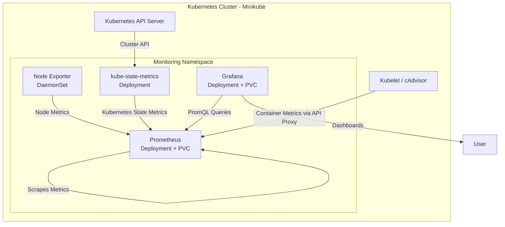

### Monitoring Flow

1. Node Exporter exposes system-level metrics from the Kubernetes node.
2. kube-state-metrics collects information about Kubernetes objects such as Pods, Deployments, Nodes, and PVCs.
3. Prometheus scrapes metrics from the configured targets.
4. Prometheus collects container metrics from the Kubelet cAdvisor endpoint through the Kubernetes API proxy.
5. Grafana connects to Prometheus as a data source and visualizes the collected metrics.

## Technologies Used

| Technology | Purpose |
|---|---|
| Kubernetes | Container orchestration |
| Minikube | Local Kubernetes cluster |
| Prometheus | Metrics collection and storage |
| Grafana | Metrics visualization and dashboards |
| Node Exporter | Node-level system metrics |
| kube-state-metrics | Kubernetes object state metrics |
| cAdvisor | Container resource usage metrics |
| YAML | Kubernetes resource configuration |
| PromQL | Querying and analyzing metrics |

## Kubernetes Components

All monitoring components were deployed in a dedicated `monitoring` namespace.

### 1. Prometheus

Prometheus was deployed using:

- Deployment
- ClusterIP Service
- ConfigMap for scrape configuration
- PersistentVolumeClaim for data persistence
- ServiceAccount
- ClusterRole and ClusterRoleBinding

Configured scrape targets:

| Job | Target | Metrics |
|---|---|---|
| prometheus | localhost:9090 | Prometheus self-monitoring |
| node | node-exporter-service:9100 | Node-level metrics |
| kube-state-metrics | kube-state-metrics-service:8080 | Kubernetes object metrics |
| cadvisor | Kubernetes Kubelet API proxy | Container metrics |

Prometheus uses persistent storage to retain its time-series data across Pod restarts.

### 2. Node Exporter

Node Exporter was deployed as a **DaemonSet**.

It exposes system metrics such as:

- CPU utilization
- Memory usage
- Filesystem usage
- Network traffic

It uses host-level mounts to access node information.

### 3. kube-state-metrics

kube-state-metrics was deployed as a Deployment with its own Service and RBAC configuration.

It exposes Kubernetes object state metrics, including:

- Pod status
- Deployment replica counts
- Node readiness
- Container restart counts
- PersistentVolumeClaim status

### 4. Grafana

Grafana was deployed using:

- Deployment
- ClusterIP Service
- PersistentVolumeClaim

It uses Prometheus as its data source and provides dashboards for monitoring cluster resources and Kubernetes workloads.

### 5. RBAC

ServiceAccounts, ClusterRoles, and ClusterRoleBindings were configured to provide the required permissions for accessing Kubernetes API resources and collecting metrics.

---

## Grafana Dashboard

A custom dashboard named **Kubernetes Cluster Monitoring** was created to visualize infrastructure and Kubernetes workload metrics.

The dashboard includes the following monitoring sections:

### Cluster Overview

Provides a quick overview of monitoring and cluster health:

- Prometheus target status
- Running Pods
- Node readiness
- PersistentVolumeClaim status
- CrashLoopBackOff containers

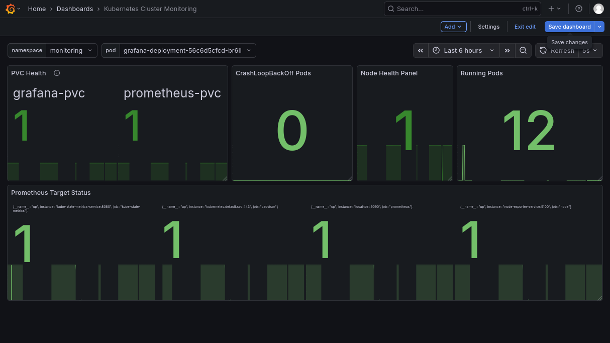

### Resource Monitoring

Visualizes node-level resource utilization:

- CPU Usage
- Memory Usage
- Disk Usage

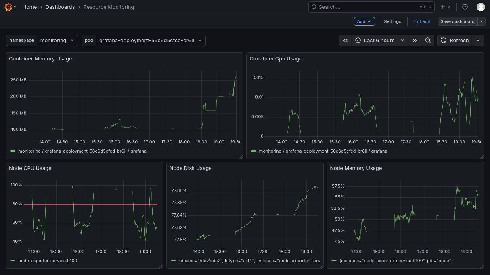

### Kubernetes Workload Monitoring

Tracks Kubernetes workload health and availability:

- Desired vs. Available Deployment Replicas
- Pod Distribution by Phase
- Pod Container Restart Counts

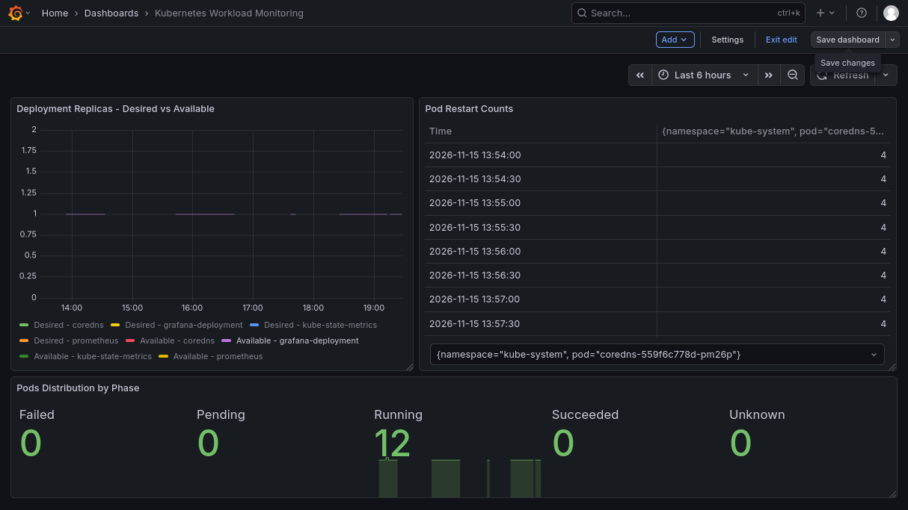

### Network Monitoring

Visualizes network traffic:

- Network Receive Traffic
- Network Transmit Traffic

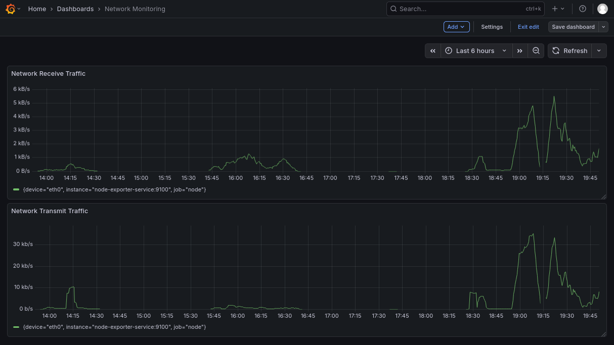

### Dashboard Variables

Grafana dashboard variables were configured to filter metrics by:

- Namespace
- Pod

This allows focused monitoring of individual Kubernetes workloads without manually changing the PromQL queries.

---

## Prometheus Metrics

Prometheus was configured to scrape metrics from four monitoring targets.

### Target Status

The Prometheus Targets page is used to verify that all configured scrape targets are healthy.

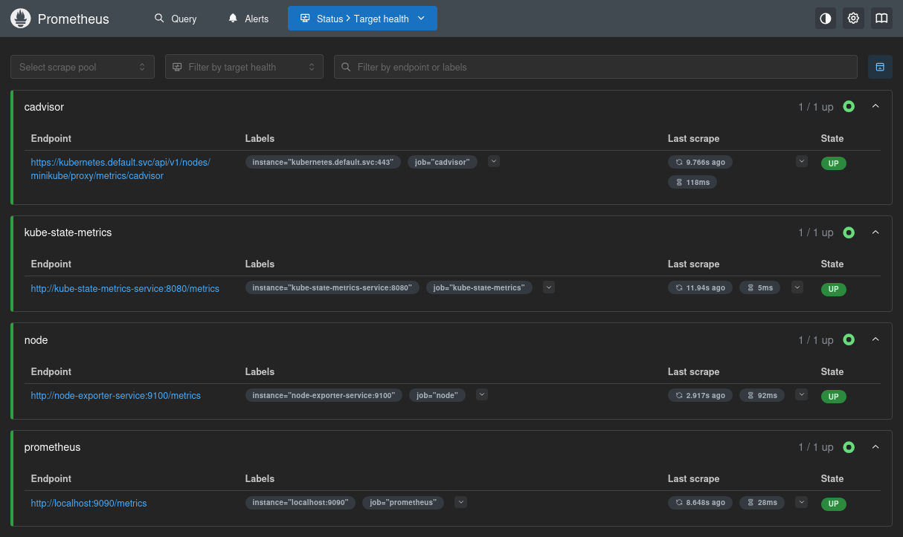

### Metrics Exploration

PromQL was used to query and inspect Kubernetes and container metrics, including:

- `up`
- `kube_pod_info`
- `kube_pod_status_phase`
- `kube_deployment_spec_replicas`
- `container_cpu_usage_seconds_total`
- `container_memory_working_set_bytes`

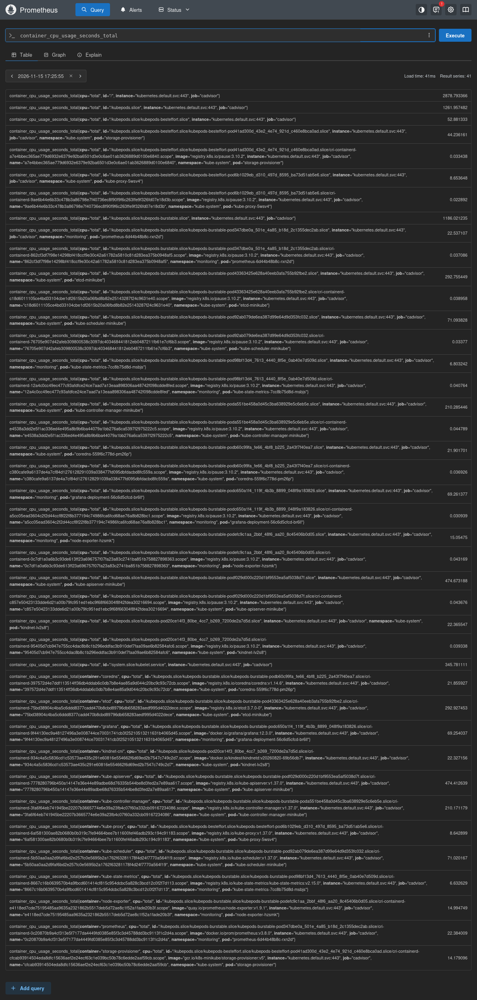

---

## Project Structure

```text
k8s-monitoring/
│
├── namespace.yml
│
├── prometheus-config.yaml
├── prometheus-deployment.yaml
├── prometheus-service.yaml
├── prometheus-pvc.yaml
├── prometheus-rbac.yaml
│
├── grafana-deployment.yaml
├── grafana-service.yaml
├── grafana-pvc.yaml
│
├── node-exporter.yaml
├── node-exporter-service.yaml
│
├── kube-state-metrics-deployment.yaml
├── kube-state-metrics-service.yaml
├── kube-state-metrics-rbac.yaml
│
├── screenshots/
│   ├── 01-grafana-overview.png
│   ├── 02-resource-monitoring.png
│   ├── 03-workload-monitoring.png
│   ├── 04-network-monitoring.png
│   ├── 05-prometheus-targets.png
│   ├── 06-prometheus-metrics.png
│   ├── 07-kubernetes-workloads.png
│   ├── 08-persistent-storage.png
│   ├── 09-kubernetes-node.png
│   └── 10-kubernetes-manifests.png
│
└── README.md
```

## Deployment Instructions

### Prerequisites

Make sure the following tools are installed:

- Docker
- Minikube
- kubectl

### 1. Start the Kubernetes Cluster

```bash
minikube start
```

Verify that the node is ready:

```bash
kubectl get nodes
```

### 2. Create the Monitoring Namespace

```bash
kubectl apply -f namespace.yml
```

### 3. Deploy the Monitoring Stack

Apply the Kubernetes manifests:

```bash
kubectl apply -f .
```

### 4. Verify the Deployments

Check the monitoring Pods:

```bash
kubectl get pods -n monitoring
```

Check Services:

```bash
kubectl get services -n monitoring
```

Check PersistentVolumeClaims:

```bash
kubectl get pvc -n monitoring
```

### 5. Access Prometheus

Forward the Prometheus Service port:

```bash
kubectl port-forward -n monitoring service/prometheus-service 9090:9090
```

Open:

`http://localhost:9090`

### 6. Access Grafana

Forward the Grafana Service port:

```bash
kubectl port-forward -n monitoring service/grafana-service 3000:3000
```

Open:

`http://localhost:3000`

Log in using the Grafana credentials configured during deployment.

---

## Verification

The following commands can be used to verify the deployed resources.

### Kubernetes Workloads

```bash
kubectl get all -n monitoring
```

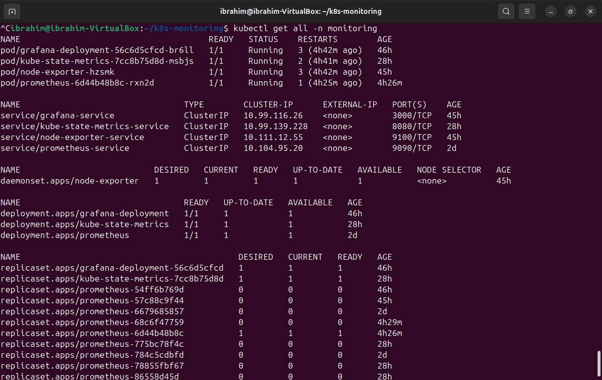

### Persistent Storage

```bash
kubectl get pvc -n monitoring
```

Both Prometheus and Grafana PVCs should reach the `Bound` state.

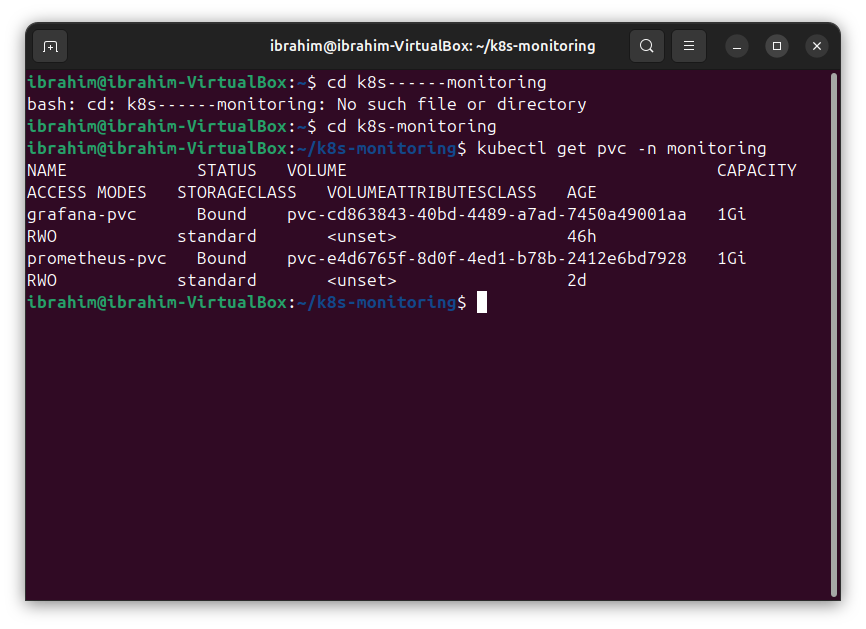

### Kubernetes Node

```bash
kubectl get nodes -o wide
```

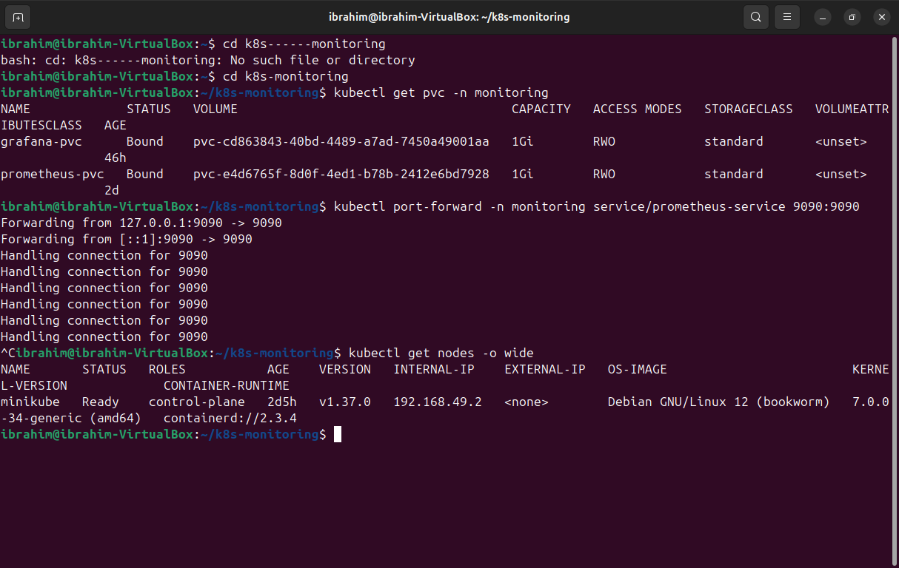

### Kubernetes Manifests

All Kubernetes resources are defined in individual YAML manifests.

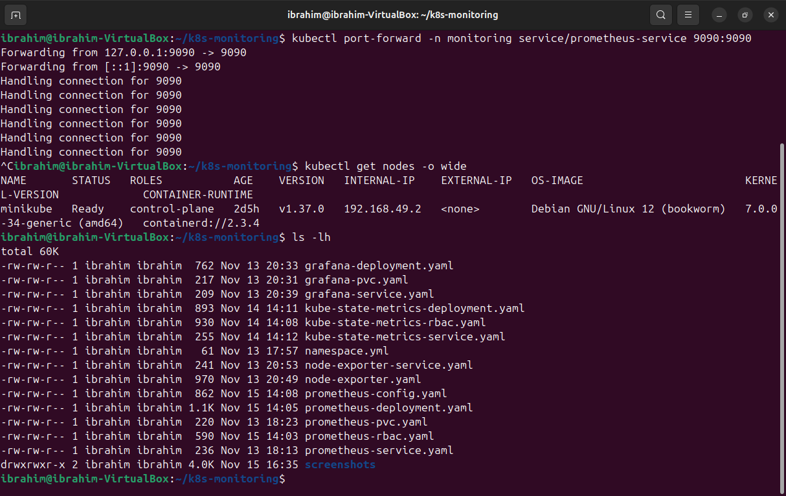

---

## Key Learnings

Through this project, I gained practical experience with:

- Deploying and managing applications inside Kubernetes.
- Understanding Deployments, DaemonSets, Services, ConfigMaps, and PersistentVolumeClaims.
- Configuring Kubernetes RBAC using ServiceAccounts, ClusterRoles, and ClusterRoleBindings.
- Deploying Prometheus and configuring multiple scrape targets.
- Understanding the relationship between Node Exporter, kube-state-metrics, cAdvisor, and Prometheus.
- Writing and experimenting with PromQL queries.
- Connecting Grafana to Prometheus.
- Building custom Grafana dashboards and using dashboard variables.
- Monitoring node resources, Kubernetes workloads, container metrics, and network traffic.
- Verifying Kubernetes deployments and troubleshooting monitoring components.

## Important Notes

- This project runs on a single-node Minikube cluster using the Docker driver.
- Node Exporter metrics represent the Minikube node environment, not necessarily the entire physical host machine.
- Disk usage in the dashboard is based on the `/data` filesystem exposed by the Minikube node environment.
- The PVC dashboard panel monitors claim binding status; it does not represent actual PVC storage utilization.
- This is a hands-on learning and portfolio project, not a production-hardened monitoring deployment.

---

## Conclusion

This project brought together Kubernetes, Prometheus, and Grafana into one monitoring environment.

It provided practical experience not only in deploying monitoring tools, but also in understanding Kubernetes resource management, metrics collection, PromQL, persistent storage, RBAC, and dashboard design.

**The main objective was to understand how the monitoring components work together inside a Kubernetes environment, rather than simply installing them.**
